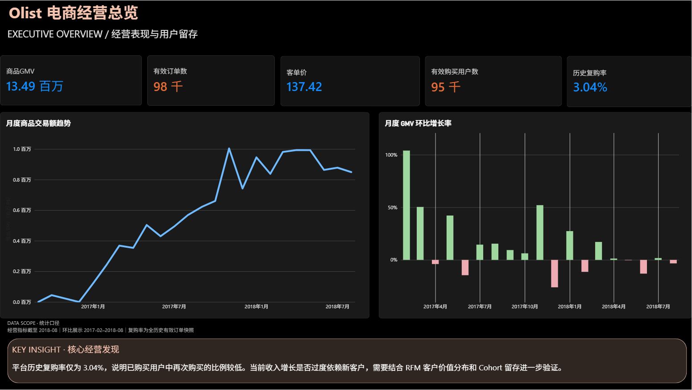

# Olist 电商经营与用户行为分析

基于 Olist 巴西电商公开交易数据，使用 **MySQL + Power BI** 完成经营表现、收入结构、用户行为和履约体验分析，并以一个轻量作品集网页展示四张 Power BI 看板。

**[在线查看作品集](https://lineana-lyu.github.io/Portfolio/)** · [下载 Power BI 原文件](downloads/Olist_电商经营分析.pbix) · [下载四页 PDF](downloads/Olist_四页看板.pdf)



## 实际分析成果

项目在 MySQL、Jupyter 和 Power BI 中完成了数据分析，不是仅展示看板模板。

| 能力证据 | 已保存的执行输出 / 看板结果 | 关键注意 |
| --- | --- | --- |
| 多维数据核对 | 月度、品类、RFM 用户、州级商品收入均为 **R$13,494,400.74** | 基于 Notebook 实际输出；商品收入不含运费 |
| 用户行为分析 | 历史购买用户 **94,983**，其中重复购买用户 **2,887**，历史复购 **3.04%** | 历史复购不等于未来流失 |
| 履约与评价关联 | 提前送达组平均评分约 **4.29**，晚到 ≥8 天组约 **1.70** | 分组差异不代表因果关系 |

结果来源与具体口径见 [三项核心成果与证据说明](docs/CASE_STUDY_FINDINGS.md)、[Notebook 执行记录](docs/NOTEBOOK_EXECUTION_EVIDENCE.md)。原始 Notebook 目前未公开上传（需先核查数据库连接信息），不能声称仓库已包含完整可复现数据与代码。

## 项目内容

| 分析方向 | 回答的业务问题 | 主要方法 |
| --- | --- | --- |
| 经营总览 | 平台交易规模与月度趋势如何？ | GMV、订单数、月度趋势与环比 |
| 收入结构 | 收入主要来自哪些品类和地区？ | 品类 GMV、州级分布、支付方式 |
| 用户行为 | 用户是否重复购买，如何理解用户差异？ | 购买频次、Cohort 月度回购、RFM |
| 履约体验 | 配送时效和客户评分有何关联？ | 配送偏差、客户评价、卖家表现 |

数据源为公开的 **Olist Brazilian E-Commerce Public Dataset**。本作品集以历史数据做描述性分析，不代表平台当前状况；RFM 不是预测流失模型，配送延迟与评分的关系不直接证明因果。

## 浏览与文件

网页采用**固定左侧菜单 + 右侧独立工作区**，避免整页下滑式展示；六个入口为「项目概览、经营总览、收入分析、用户行为、履约体验、技术与证据」。概览页由项目介绍、三项并排数据摘要、真实 Power BI 预览和精简的分析过程组成；四页报表尽量以**原始大屏截图**为主视觉；技术页以**双栏文档布局**展示问题与对应 SQL。右侧内容较长时，仅右侧独立滚动。手机端左上角展开菜单；`#overview`、`#revenue` 等哈希支持深链接和后退/前进。截图可点击放大，支持左右键切换；PBIX/PDF 下载不变。

**网页里展示的是静态看板图片，不能直接操作 Power BI 图表。** 如需使用 Power BI 的原生筛选及交叉联动，请下载 `.pbix` 并在 Power BI Desktop 中打开。部分模型刷新操作可能需要重新配置原始数据文件路径。

| 文件或目录 | 用途 |
| --- | --- |
| `index.html` | 固定侧栏、右侧工作区、三种视图模板与资源入口 |
| `styles.css` | 字体排版体系、横向数据摘要、原图优先的报表布局、侧栏和移动端适配 |
| `gallery.js` | 六路由切换、浏览器哈希导航、侧栏状态和看板放大 |
| `assets/` | 4 张 Power BI 导出图片 |
| `downloads/` | 原始 `.pbix` 与 PDF |
| `docs/CASE_STUDY_FINDINGS.md` | 分析成果的来源、指标与限制 |
| `tests/site_smoke.py` | 桌面 / 移动端基本交互检查 |
| `docs/` | 项目质量检查及早期 SDD 归档 |

本项目使用**原生 HTML / CSS / JavaScript**，不依赖第三方前端框架或构建步骤；保留截图和源文件的原始格式。

## 关键 SQL 与结果对账

本仓库新增 3 份可独立运行的 MySQL 8.0+ 分析脚本：

- [用户历史复购](sql/01_customer_repeat_purchase.sql)：用户去重、有效订单范围与复购率。
- [Cohort 月度回购](sql/02_cohort_monthly_repeat.sql)：首购月份及完整可观察月份的回购。
- [配送时效 × 客户评分](sql/03_delivery_review_by_delay.sql)：订单级评价、延迟分层和评价覆盖率。

具体运行方法见 [SQL 使用说明](sql/README.md)，待核验数据与统计差异见 [SQL 对账清单](docs/SQL_VALIDATION.md)。

**状态说明：**原项目 SQL 已运行，并在 Notebook 留有真实数据结果和四项商品收入一致性校验（[执行记录](docs/NOTEBOOK_EXECUTION_EVIDENCE.md)）；新整理的三份 SQL 是**待核对口径差异的修订版**，不是原项目第一次运行。现有看板数字不应宣称已经由修订版重新对账。

## 本地运行

直接双击 `index.html`，或在仓库目录运行：

```bash
python -m http.server 8000
```

然后打开 `http://localhost:8000/`。

需要运行浏览器冒烟检查时，先安装 Python Playwright 和 Chromium：

```bash
pip install playwright
playwright install chromium
python tests/site_smoke.py
```

## 部署

静态网站使用 **GitHub Pages**，从 `main` 分支根目录发布。提交 HTML/CSS/JS 后，Pages 会更新公开页面；`assets/` 和 `downloads/` 与网页位于同一仓库。

## 设计来源与说明

浅灰纸张背景、珊瑚色强调和编辑式排版语言沿用个人项目 [personal_website](https://github.com/lineana-lyu/personal_website) 的设计语言；没有移植全屏 Hero、视频、3D 或复杂动效。布局进一步参考侧栏式作品展示与成熟产品的导航层级：**概览不重复造导航卡片，看板不使用仿浏览器装饰，技术证据不再堆积三列小卡片**。

页面优化不会改变 Power BI 的统计结果。具体指标口径与数据质量仍以原始 SQL / Power BI 计算逻辑为准；在公开历史数据中得出的建议不等于已落地的运营效果。
